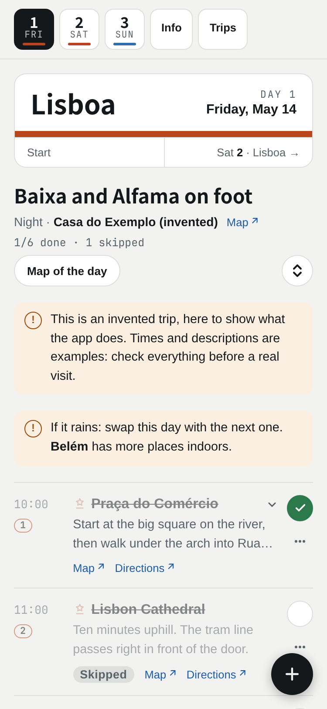
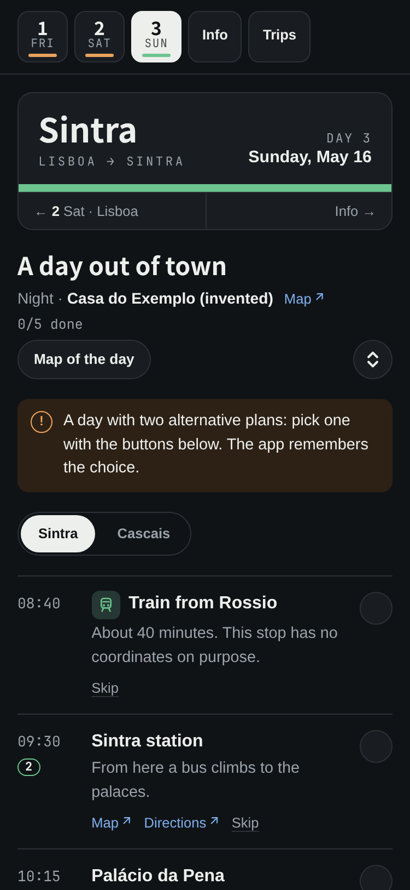

# Travel in my pocket

[](https://github.com/Frafal/TIMP/actions/workflows/deploy.yml)
[](LICENSE)

**Open the app: <https://frafal.github.io/TIMP/>**

A pocket travel guide that opens on your phone and keeps working without internet.

The app is the same for everyone and contains no trip. **Your trip is a file** that you
load into the app: it stays on your phone and is never uploaded anywhere. That is why
the app can be public and open source while your hotels and dates stay private.

<p align="center">
  
  
  
  
</p>

<p align="center"><sub>The example trip: programme of the day, interactive map, offline sketch, alternative plans in the dark theme.<br>
Retake them with <code>node tools/screenshots.mjs</code>.</sub></p>

- Day-by-day programme: times, descriptions, reminders, alternative plans for a day.
- Short descriptions: two lines each, tap one to read it all, or open them all at once.
- Metro, train, plane and boat at a glance: an icon next to the stop and on the map.
- Tick the stops you have done, or skip the ones you leave out. The app remembers both.
- A map for every day: interactive when you are online (Google Maps or OpenStreetMap),
  a sketch to scale when you are not. What is behind you is drawn dashed.
- One tap to open any stop in Google Maps, with directions.
- An Info page for hotels, phone numbers, money, useful phrases.
- Works on iPhone and Android. Installs on the Home Screen, no app store.
- Interface in English and Italian: it follows the trip file, or the language you choose.
- Light and dark theme: it follows the phone, or the one you choose. Maps follow it too.

## Use it

1. Open <https://frafal.github.io/TIMP/>.
2. Install it on the Home Screen:
   - **iPhone**: open the page in Safari, tap Share, then "Add to Home Screen".
   - **Android**: open the browser menu, tap "Install app" or "Add to Home screen".
3. Open it from the new icon and tap **Load a trip file**. Pick the `.json` file you
   received (from Files, Drive, a chat).
4. Done. From now on it also opens in airplane mode.

No trip file yet? Tap **Try the example trip**.

Good to know:

- **iPhone: load the trip from the Home Screen icon, not from Safari.** The two keep
  separate storage. Installed on the Home Screen, the trip is also safe from Safari's
  habit of clearing data of sites not visited for a week.
- **Open the app once with a connection** before you leave, so the phone can save it.
- **The phone holds the only copy.** Keep the trip file somewhere (Files, Drive, a chat)
  in case you change phone or clear the browser data.
- **To update a trip**, load the new version of the file from the Trips page. The stops
  already ticked stay ticked.
- You can keep several trips on the same phone and switch between them from Trips.

## Create your own trip

A trip is a JSON file. [docs/creating-a-trip.md](docs/creating-a-trip.md) explains how
to write one, [docs/trip-format.md](docs/trip-format.md) lists every field, and
[examples/demo-trip.json](examples/demo-trip.json) is a complete example.

### With an AI assistant

Any assistant can write a trip file, because the instructions are two plain documents:
[docs/creating-a-trip.md](docs/creating-a-trip.md) (how to write a good one) and
[docs/trip-format.md](docs/trip-format.md) (every field).

- **A coding agent** (Claude Code, Codex, Cursor, Copilot and others): clone the
  repository, open the folder, and describe your trip or hand over your notes:
  *"Create a trip file for my week in Portugal, here is the plan…"*. The agent finds
  its instructions in [AGENTS.md](AGENTS.md), writes the file into `private/` (a folder
  Git ignores) and checks it.
- **A chat assistant** (ChatGPT, Claude, Gemini and others): attach the two documents
  above and your notes, and ask for a trip file. Load the result in the app: if
  something is wrong, the app lists each problem with its position in the file. Paste
  that list back into the chat and ask for a corrected file.

Whatever you use, look at the map of each day before you leave: a pin in the wrong
place is the one mistake no automatic check can catch.

### By hand

Copy `examples/demo-trip.json`, edit it following
[docs/creating-a-trip.md](docs/creating-a-trip.md), then check it:

```bash
node tools/validate-trip.mjs --map my-trip.json
```

It reports mistakes with the exact position in the file. With `--map` it also prints
how the stops of each day group on the map, which is the quickest way to spot a wrong
coordinate.

### Keep your trip out of the repository

A trip file has your hotels and your dates. Do not commit it. The `private/` folder
and any file ending in `.private.json` are ignored by Git for this reason.

## Google Maps (optional)

Without any setup the interactive map uses OpenStreetMap. If you prefer Google Maps,
you need a key from Google. The key belongs to whoever prepares the trip: put it in the
trip file and everyone who receives the file gets the Google map without doing anything.

1. Go to the [Google Cloud console](https://console.cloud.google.com/) and create a project.
2. Enable billing on the project. Google asks for a card even if you stay within the
   free allowance.
3. In "APIs & Services → Library", enable **Maps JavaScript API**.
4. In "APIs & Services → Credentials", create an **API key**.
5. Restrict the key. This is what makes it safe to share:
   - Application restriction: **Websites**, with the address of the app, for example
     `https://frafal.github.io/TIMP/*` (or the address of your own copy)
   - API restriction: **Maps JavaScript API** only.
6. Set a daily limit in "Google Maps Platform → Quotas → Maps JavaScript API": find
   "Map loads per day", untick "Unlimited" and enter 300 or less. At 300 a day the
   month can never exceed the free allowance, so the key cannot cost anything.
7. Add the key to the trip file:

   ```json
   "map": {"googleMapsKey": "AIza..."}
   ```

Cost: the key itself is free. Google includes 10,000 free map loads a month and charges
about $7 per 1,000 beyond that (figures from November 2026: check the
[current prices](https://developers.google.com/maps/billing-and-pricing/pricing)).
A group of travellers uses a few hundred, and the daily limit of step 6 keeps it at zero.

If Google refuses the key (wrong site, quota reached), the app says so and shows
OpenStreetMap instead.

On each device, the Trips page shows which map is in use and lets you:

- save a key that applies to every trip on that device, in place of the trip's key;
- turn Google Maps off and use OpenStreetMap even when a key is present, to save
  map loads when you do not need Google's map.

What the map cannot do: Google does not allow its maps to be saved for offline use, so
without a connection the app shows the sketch. Lines between stops are straight; for
real routes and transport times, tap "Directions" on a stop.

## Privacy

- Trip files are read on the device and stored in the browser's local database
  (IndexedDB). They are never sent to the server that hosts the app.
- The app has no accounts, no analytics, no cookies and no third-party fonts or scripts
  at startup. The only library, Leaflet, is served with the app.
- When you open the interactive map, map images are requested from OpenStreetMap or
  Google, who therefore see your IP address and the area you look at.
- "Map" and "Directions" links open Google Maps.

## Host your own copy

The app is static files. Any host with HTTPS works.

**With GitHub Pages**

1. Fork this repository.
2. In the fork: Settings → Pages → Source: **GitHub Actions**.
3. In the fork: Actions → enable workflows, then run "Deploy" (or push a commit).

Every push to `main` then runs the checks and publishes the app at
`https://<you>.github.io/<repository>/`. The links to the documentation inside the app
point to your fork automatically.

**Anywhere else**

```bash
node tools/build.mjs --repo https://github.com/<you>/<repository>
```

Upload the content of `dist/` to your host.

If you use a Google Maps key, restrict it to the address of your copy.

## Develop

Nothing to install. Start any static server in the folder:

```bash
python3 -m http.server 4173
```

Then open `http://localhost:4173/`. Opening `index.html` as a file does not work:
browsers refuse modules and service workers there.

Node 20 or later is needed only for the checks:

```bash
npm run check
```

```bash
npm test
```

```bash
npm run e2e
```

The last one opens the app in headless Chrome or Chromium with the example trip and
checks what unit tests cannot see: folding, skipping, the dashed map, the language,
a hostile trip file. It needs Chrome or Chromium installed.

On `localhost` the service worker always serves the files on disk, so every reload
shows your changes; it uses its copy only when the server is off. On the published
site the build stamps a version computed from the app's content: phones that already
have the app see an "Update" button only when something really changed.

How the code is organised, the rules for changes and how to add a language are in
[CONTRIBUTING.md](CONTRIBUTING.md).

## Contributing

Ideas, bug reports and pull requests are welcome. Start from
[CONTRIBUTING.md](CONTRIBUTING.md). When you report a problem, please do not attach
your real trip file: issues are public.

## License

[MIT](LICENSE) © 2026 Francesco Falqui. You are free to use, change and redistribute
the project; the licence asks that the copyright notice stays in every copy.

Leaflet is distributed under its own
[BSD 2-Clause license](vendor/leaflet/LICENSE). Map data © OpenStreetMap contributors.
