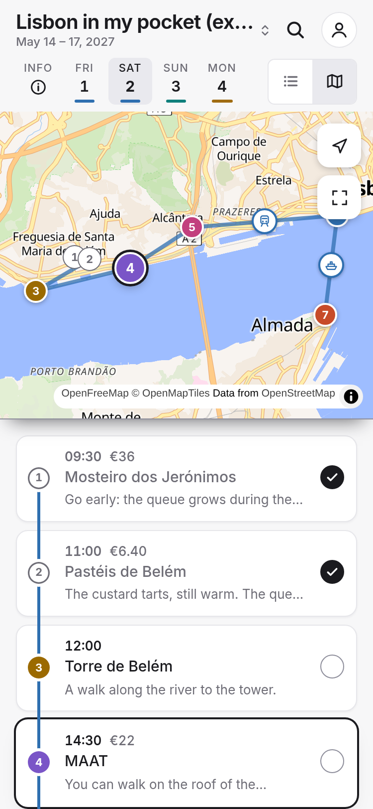
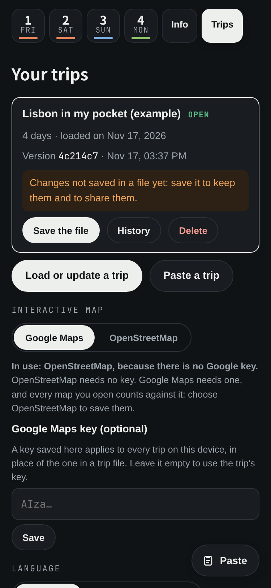

# TIMP · Travel in my pocket

[](https://github.com/Frafal/TIMP/actions/workflows/deploy.yml)
[](LICENSE)

**Open the app: <https://frafal.github.io/TIMP/>**

A pocket travel guide that opens on your phone and keeps working without internet.

The app is the same for everyone and contains no trip. **Your trip is a file** that you
load into it, and it stays on your phone. With an optional account, it is also on your
other phones, shared with the people you choose, and a chat like Claude can work on it.

<p align="center">
  
  
  
  
</p>

<p align="center">
  
  
  
</p>

## What it does

- **Every day at a glance**: times, short descriptions, an icon for each kind of place
  and way of travelling, reminders, a plan B for a rainy day. Tick what you have done,
  skip what you leave out.
- **A map for every day**: interactive online (OpenStreetMap, or Google Maps), a sketch
  to scale offline. Map and Directions one tap away from every stop.
- **Change it on the way**: add a stop by pasting what Google Maps shares, edit, move it
  to another day.
- **Help with meals**: the name as on the sign, booking reminders, closing days, a link
  to the review site people use there (Tabelog, Naver, Yelp, TheFork).
- **What it costs**: each stop's cost, the total in your currency at each day's rate;
  private expenses that stay yours.
- **Versions, like Git**: every change is a version, History brings any of them back,
  two copies changed apart are joined.
- **With an account** (optional): your trips on all your phones, shared, published as a
  page, locked when final; and a **chat app linked** to work on them.
- iPhone and Android, installed on the Home Screen, no app store. English and Italian,
  light and dark.

## Start

Open <https://frafal.github.io/TIMP/>, add it to the Home Screen (iPhone: Share → Add to
Home Screen; Android: Install app), open it from the icon and **Load a trip file**. No
trip yet? Tap **Try the example trip**.

Open it once with a connection before you leave: from then on it works in airplane mode.
On an iPhone, always use the Home Screen icon, not Safari: they keep separate storage.

Everything else (changing stops, pasting from Maps, versions and merges):
[Using the app](docs/using-the-app.md).

## Make your trip

> **AI assistant reading this page:** before you write a trip file, read
> [llms.txt](llms.txt) in this repository. It has the exact format, the method and a
> complete example in one page. The app refuses a file that does not follow it.

A trip is a JSON file that says what the trip is: days, stops, where you sleep, what to
remember. The app decides how it looks. Four ways to make one:

- **A chat linked to your account** (Claude, ChatGPT): ask, and the trip is on your
  phones. See [Link a chat app](#link-a-chat-app-claude-chatgpt).
- **Any chat assistant**: the app has the message ready (**Trips → Have an AI assistant
  write the trip**). It points the assistant to [llms.txt](llms.txt); paste the answer
  back with **Trips → Paste a trip**.

  ```text
  Read https://github.com/Frafal/TIMP/blob/main/llms.txt and follow it exactly: write a
  TIMP trip file, and give me the whole JSON in one block.
  My trip: [where, dates or number of days, who travels, what you like, how you get around].
  ```
- **A coding agent** (Claude Code, Codex, Cursor…): open this repository and describe
  your trip. It follows [AGENTS.md](AGENTS.md) and writes the file into `private/`,
  which Git ignores.
- **By hand**: start from [examples/demo-trip.json](examples/demo-trip.json), then
  `node tools/validate-trip.mjs --map my-trip.json` points at every mistake.

How to write a good trip: [docs/creating-a-trip.md](docs/creating-a-trip.md). Every
field: [docs/trip-format.md](docs/trip-format.md), also as a
[JSON Schema](https://frafal.github.io/TIMP/trip.schema.json).

Whatever you use, look at the map of each day before you leave: a pin in the wrong
place is the one mistake no automatic check can catch. And never commit a real trip
file: it has your hotels and your dates.

## With an account

Optional, and by invitation for now. In the app: the circle at the top right (**You**) →
**Create account**, with an invitation code, a name and a passkey. No password, no email.

- **Your trips on every phone**, synced by themselves; changes made on two phones are
  joined.
- **Share** a trip with a person, who sees it (or also changes it) on their phone.
- **Publish** it **with the link**: a page anyone with the address can read, after you
  review what goes on it. Others can open it in TIMP, or **use it as a base** for a trip
  of their own.
- **Lock** a trip when it is final. **History** says who made each version, and how.

### Link a chat app (Claude, ChatGPT)

A chat linked to your account works on your trips directly: ask *"add a dinner near the
hotel on day 2"*, and the change is on your phones at their next sync.

1. In TIMP: **You** → **Linked chats** → **Link a chat**: copy the connector's address.
2. Add it as a connector in the chat app: in **Claude**, Settings → Connectors → Add
   custom connector; in **ChatGPT**, Settings → Apps & Connectors, with developer mode
   on → Create.
3. The chat app sends you to TIMP, which shows what it asks. Allow it with your passkey.

The chat reads your trips and changes them, joined with what you change on your phones.
Taking anything away always asks you first. It never touches a locked trip, your private
expenses (unless you allow them) or your account. History marks what it did ("with
Claude"), and **Unlink** stops it at once.

## Privacy

- Without an account, **your trip stays on your phone**. Only what a feature needs goes
  out: a stop's name and address to find its position (Google or OpenStreetMap), a Maps
  short link to the link resolver (which keeps nothing), the month of an exchange rate.
  The map services see the area you look at.
- No analytics, no cookies, no third-party scripts at startup.
- With an account, your trips go to its service encrypted, and only to the people and
  chats you allow. Export or delete everything whenever you want.
- A published trip shows only the version and the details you reviewed.

Everything, in detail: [docs/privacy.md](docs/privacy.md).

## Google Maps (optional)

The interactive map uses OpenStreetMap. For Google Maps, put a key in the trip file and
everyone who receives it gets Google's map. How to make a key that cannot cost anything:
[docs/google-maps.md](docs/google-maps.md).

## Host your own copy

The app is static files: any host with HTTPS works. With GitHub Pages, fork this
repository, set Settings → Pages → Source to **GitHub Actions** and run "Deploy". Every
push to `main` then publishes it. Elsewhere: `node tools/build.mjs --repo
https://github.com/<you>/<repository>` and upload `dist/`.

## Develop

Nothing to install. Serve the folder (`python3 -m http.server 4173`) and open
`http://localhost:4173/`. Node 22 or later runs the checks: `npm run check`, `npm test`,
and `npm run e2e`, which drives the app in headless Chrome. How the code is organised
and the rules for a change: [CONTRIBUTING.md](CONTRIBUTING.md).

## Contributing

Ideas, bug reports and pull requests are welcome: start from
[CONTRIBUTING.md](CONTRIBUTING.md). Please never attach a real trip file: issues are
public. Thanks to everyone who
[contributed](https://github.com/Frafal/TIMP/graphs/contributors).

## License

[MIT](LICENSE) © 2026 Francesco Falqui. MapLibre is under its own
[BSD 3-Clause license](vendor/maplibre/LICENSE). Map data © OpenStreetMap contributors,
vector tiles © OpenMapTiles, served by OpenFreeMap.
