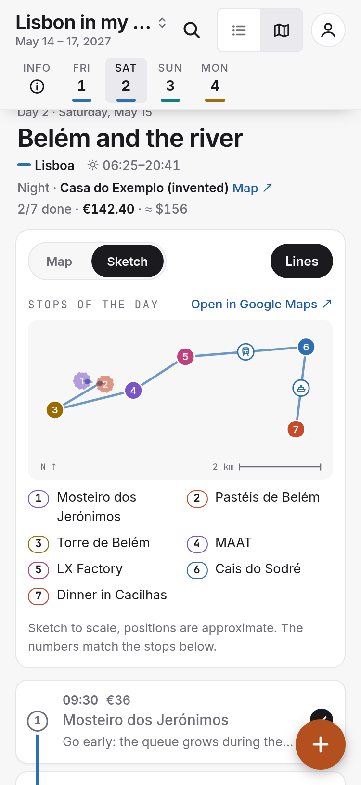
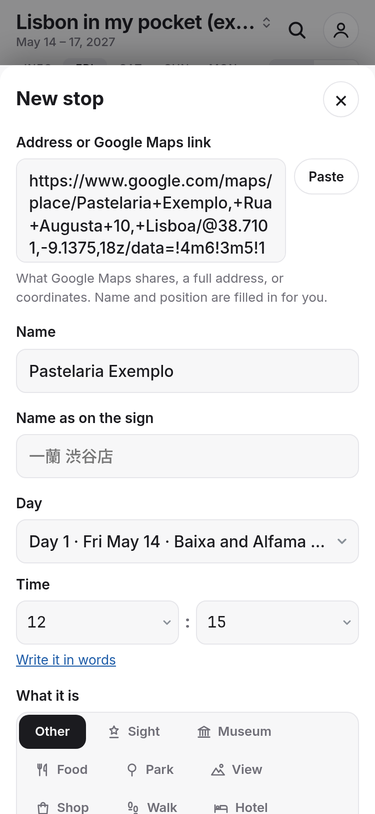
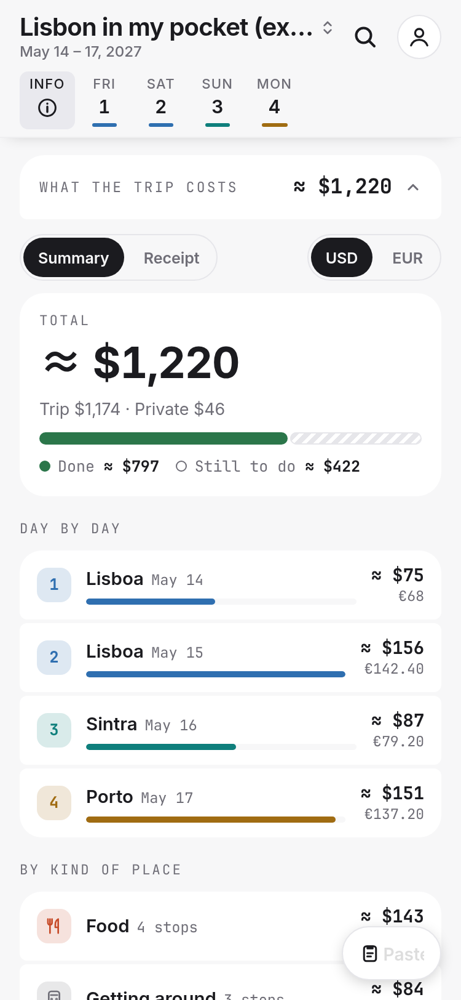

# TIMP · Travel in my pocket

[](https://github.com/Frafal/TIMP/actions/workflows/deploy.yml)
[](LICENSE)

**Open the app: <https://frafal.github.io/TIMP/>**

A pocket travel guide that opens on your phone and keeps working without internet.

The app is the same for everyone and contains no trip. **Your trip is a file** that you
load into the app: it stays on your phone and is never uploaded anywhere. That is why
the app can be public and open source while your hotels and dates stay private.

<p align="center">
  
  
  
  
</p>

<p align="center">
  
  
  
</p>

<p align="center"><sub>The example trip: programme of the day, interactive map, offline sketch, alternative plans in the dark theme;
a stop added from a Google Maps link, the trip's version on the Trips page, and what the trip costs.<br>
Retake them with <code>npm run screenshots</code>.</sub></p>

- Day-by-day programme: times, descriptions, reminders, alternative plans for a day.
- Short descriptions: two lines each, tap one to read it all, or open them all at once.
- What each stop is at a glance: an icon for sights, museums, food, parks, views, shops,
  walks and hotels, by the stop and on its pin; another for metro, bus, train, plane
  and boat on the way there.
- Add and change stops on the phone: paste what Google Maps shares, or an address.
- Every change is a version, like a commit in Git. Share the file, and when a friend
  changed it too, the app joins the two.
- Tick the stops you have done, or skip the ones you leave out. The app remembers both.
- Each stop at a glance: time, pin number and how you get there on the left, a label
  like "Booking needed" above the title, Map and Directions always one tap away.
- A map for every day: interactive when you are online (Google Maps, or OpenStreetMap
  drawn by the phone, with names you can read: "Kyoto" over "京都市"), a sketch to scale
  when you are not. Each pin has the colour of its kind of place,
  lighter in the morning and darker after sunset; what is behind you is drawn dashed,
  and the lines between the stops can be hidden. Hold a stop's number in the list to
  see it on the map.
- Sunrise and sunset of each day, worked out on the phone from the date and the place,
  and a moon by the stops after dark.
- One tap to open any stop in Google Maps, with directions.
- An Info page for hotels, phone numbers, money, useful phrases.
- What the trip costs you: each stop's cost (your share, when it is split), small by
  its time; flights and hotels paid before leaving; and at the end of Info the total in
  your currency, day by day and by kind of place, or as a receipt. Each cost is
  converted at the rate of its own day.
- Private expenses, for what you buy only for yourself: on your phone, out of the
  versions and merges, and in a file only when you save it with them.
- Works on iPhone and Android. Installs on the Home Screen, no app store.
- Interface in English and Italian: it follows the trip file, or the language you choose.
- Light and dark theme: it follows the phone, or the one you choose. Maps follow it too.

## Use it

1. Open <https://frafal.github.io/TIMP/>.
2. Install it on the Home Screen:
   - **iPhone**: open the page in Safari (or Chrome), tap Share, then "Add to Home Screen".
   - **Android**: open the browser menu, tap "Install app" or "Add to Home screen".
3. Open it from the new icon and tap **Load a trip file**. Pick the `.json` file you
   received (from Files, Drive, a chat).
4. Done. From now on it also opens in airplane mode.

No trip file yet? Tap **Try the example trip**.

Good to know:

- **iPhone: load the trip from the Home Screen icon, not from Safari.** The two keep
  separate storage. Installed on the Home Screen, the trip is also safe from Safari's
  habit of clearing data of sites not visited for a week.
- **Open the app once with a connection** before you leave, so the phone can save it.
- **The phone holds the only copy.** Keep the trip file somewhere (Files, Drive, a chat)
  in case you change phone or clear the browser data.
- **To update a trip**, load the new version of the file from the Trips page. The stops
  already ticked stay ticked.
- You can keep several trips on the same phone and switch between them from Trips.

### Coming from 1.x

Nothing to do for the trips: on first start 2.0 gives each of them a version, and the
ticked stops stay. The new name, the new icon and the Share menu on Android come from
the app's manifest, which phones read when the app is installed: Android refreshes them
within a few days, an iPhone never. To get them now, save your trips as files from
Trips, remove the app from the Home Screen, add it again and load the files.

## Change the trip on the way

Tap **+** at the bottom right of a day to add a stop. Each stop has a **⋯** button under
its tick: **Edit** changes it, moves it to another day or deletes it; **Skip** marks a
stop you leave out. On the map a skipped stop keeps its pin, greyed, and the route goes
from the stop before it straight to the one after.

The day has its own **⋯**, next to Map of the day: **Edit day** changes its city, title,
where you sleep and its notes, or deletes it; **Add a day** opens the stop form on a new
day after the last (staying one more day: the day is made with its first stop).
Alternative plans for a day, like one for when it rains, are a job for an AI assistant
(below): "add a plan for day 3 if it rains" is all it takes.

**Places to eat** get more help, because a meal is the easiest thing to lose:

- The name as on the sign, under the title ("一蘭 渋谷店"): to find the door, and to show
  it to the staff or a taxi driver.
- **Booking**: a stop that needs one shows a warning until you mark it done in the form
  (Booking: Done); then it shows Booked.
- **Closing days**: a stop on a day its place is closed shows a warning, also after you
  move it to another day.
- A link to the reviews people use there, searched by the local name or the title:
  **Tabelog** in Japan, **Naver** in Korea, **Yelp** in the United States and Canada,
  **TheFork** in Europe (a web search of its pages: it lists only the restaurants it
  works with, so the results show at once whether the place is there). Nothing is
  fetched: the link opens only when you tap it.

The quickest way to fill in a stop is to paste what Google Maps gives you. The form
reads it on the phone:

| You paste | The stop gets |
|---|---|
| A link copied from Google Maps in a browser (`google.com/maps/place/…`) | name, address, position |
| The text the Maps app shares (name, address, link) | name, address; the position is looked up |
| A full address | the address; the position is looked up |
| A short link (`maps.app.goo.gl/…`), or the Maps app's text with one | name, address, position and kind of place, through the link resolver (below); without it, the link, and the name and address the text gives |
| Coordinates, `geo:` links, Apple Maps links | the position |

**Android:** once the app is installed, it appears in the Share menu: share a place from
Google Maps and the form opens already filled in; share an AI assistant's answer, or a
`.json` file, and the trip or the changes are loaded. (After an update, Android can take
a day to learn that TIMP accepts files; removing the app and installing it again is
immediate.)
**iPhone:** iOS does not let web apps receive shared content, whatever the browser they
were installed from. Copy instead, then tap **Paste** at the bottom of the app and
**Paste** in the sheet that opens: what you copied appears in the field, and
**Continue** does the same as the Share menu on Android. In Maps, Share → Copy; from an
AI assistant, copy the answer. A `.json` file: save it in Files and use **Load a trip
file**. (iPhone shows its own small Paste bubble first: tap it.)

When a position has to be looked up, the app asks Google (with a key that has the
Geocoding API enabled, see below) or OpenStreetMap otherwise. It searches around the
stops of that day first, because Maps often shares an address without its town. If the
pin lands in the wrong place, or nothing is found, tap **On the map** and put it where
it belongs. A stop without a position is saved without a pin: its Map and Directions
links work all the same.

When the place is known, its kind (museum, restaurant, park…) is filled in too, from
OpenStreetMap or Google.

**The link resolver.** A browser is not allowed to follow a short link to the place
(Google sends no CORS header). So the app asks a tiny service of this project, the
[link resolver](worker/README.md), which follows the link and answers with name,
address, position and kind of place. Only the link is sent, and the resolver keeps
nothing. It is optional: a copy of the app without one reads full links on its own and
asks for the name of a short one.

### Versions and sharing a changed trip

Each change makes a new version of the trip, with an id like Git's, shown on the
Trips page (`Version 3f2a9c1`). After a change the app offers to **save the file**:
on an iPhone that opens the share sheet (WhatsApp, Drive, Files…); on Android and on
a computer it downloads `<trip>-<version>.json`, because Chrome does not share `.json`
files. Send it from Downloads. Trips shows a notice until the latest version
has been saved.

When someone loads a file of a trip they already have (same trip `id`):

- **a newer version** made from theirs replaces it;
- **an older one** changes nothing, unless they tap **Use this one**: the old content
  then comes back as a new version, and nothing is lost;
- **a version that changed separately** shows what is new in the file and what is new
  on the phone, and asks:
  - **Join both** merges the two: stops added on either side are kept, a stop changed on one
    side takes that change, a stop removed on one side and untouched on the other goes.
    When both changed the same detail, the same side wins on every phone, so two
    friends who swap files end on the same version;
  - **Use only the file** keeps the file as it is, as a new version that still remembers the
    phone's changes;
  - **Cancel** loads nothing.

**History** (on the Trips page) lists the versions on the phone with what each one
added, removed or changed, and can bring any of them back. Going back makes a new
version with the old content, the way `git revert` does, so it can itself be undone.

Ticked and skipped stops are never part of the file: they stay on each phone.

## Create your own trip

> **AI assistant reading this page:** before you write a trip file, read
> [llms.txt](llms.txt) in this repository. It has the exact format, the method and a
> complete example in one page. The app refuses a file that does not follow it.

A trip is a JSON file that says what the trip is: days, stops, where you sleep, what to
remember. The app takes care of how it looks (colours, maps, icons). The smallest one:

```json
{
  "format": "travel-in-my-pocket/2",
  "title": "Rome in three days",
  "days": [{"date": "2027-04-10", "city": "Rome", "stops": [{"time": "09:00", "title": "Colosseum", "type": "sight"}]}]
}
```

[docs/creating-a-trip.md](docs/creating-a-trip.md) explains how to write a good one,
[docs/trip-format.md](docs/trip-format.md) lists every field, and
[examples/demo-trip.json](examples/demo-trip.json) is a complete example. The same rules
are published as a JSON Schema, `trip.schema.json`, next to the app.

### With an AI assistant

Any assistant can write a trip file, because the instructions are two plain documents:
[docs/creating-a-trip.md](docs/creating-a-trip.md) (how to write a good one) and
[docs/trip-format.md](docs/trip-format.md) (every field).

- **A coding agent** (Claude Code, Codex, Cursor, Copilot and others): clone the
  repository, open the folder, and describe your trip or hand over your notes:
  *"Create a trip file for my week in Portugal, here is the plan…"*. The agent finds
  its instructions in [AGENTS.md](AGENTS.md), writes the file into `private/` (a folder
  Git ignores) and checks it.
- **A chat assistant** (Gemini, ChatGPT, Claude and others): give it
  [llms.txt](llms.txt), the whole format in one page, kept in this repository. The app
  has the message ready, on the first screen and in **Trips → Have an AI assistant
  write the trip**:

  ```text
  Read https://github.com/Frafal/TIMP/blob/main/llms.txt and follow it exactly: write a
  TIMP trip file, and give me the whole JSON in one block.
  My trip: [where, dates or number of days, who travels, what you like, how you get around].
  ```

  Write your trip in the app's box and the message is copied with it as its last
  line; or leave the box empty and fill in the part in brackets in the chat: it is
  always the last line, also in the longer messages (with the whole format, or with
  the trip to change).

  Then copy the whole answer and tap **Trips → Paste a trip**. If something is wrong,
  the app lists each problem with its position in the file; **Copy for the assistant**
  copies that list with a request to fix it. Paste it into the same chat and load the
  new answer.

  An assistant that cannot open the link at all: the app's **Copy the message with the
  whole format** puts the format itself, about forty lines, in the message.
- **A model that follows a JSON Schema** (open models through Ollama, llama.cpp or
  vLLM, or an API with structured output): give it
  [trip.schema.json](https://frafal.github.io/TIMP/trip.schema.json) as the output
  format, and the file comes out well formed by construction.

Whatever you use, look at the map of each day before you leave: a pin in the wrong
place is the one mistake no automatic check can catch.

**Changing a trip you already use:** small changes are quicker in the app (+ and Edit).
For bigger ones, at the bottom of **Trips** open **Have an AI assistant change this
trip**: one button copies a message with an outline of the trip, you write what to
change, and the assistant answers with the changes only, a few lines instead of the
whole file. Copy them and tap **Paste** (on Android, share the answer to TIMP):
the app applies them as a new version, and Undo is one tap in History. The assistant
can also add, rename or remove a day's alternative plans: ask for a plan B for a rainy
day, and the day gets two buttons to choose from. A coding agent
can also work on the latest file the app saved (Trips → Save the file).

### By hand

Copy `examples/demo-trip.json`, edit it following
[docs/creating-a-trip.md](docs/creating-a-trip.md), then check it:

```bash
node tools/validate-trip.mjs --map my-trip.json
```

It reports mistakes with the exact position in the file. With `--map` it also prints
how the stops of each day group on the map, which is the quickest way to spot a wrong
coordinate.

### Keep your trip out of the repository

A trip file has your hotels and your dates. Do not commit it. The `private/` folder
and any file ending in `.private.json` are ignored by Git for this reason.

## Google Maps (optional)

Without any setup the interactive map uses OpenStreetMap. If you prefer Google Maps,
you need a key from Google. The key belongs to whoever prepares the trip: put it in the
trip file and everyone who receives the file gets the Google map without doing anything.

1. Go to the [Google Cloud console](https://console.cloud.google.com/) and create a project.
2. Enable billing on the project. Google asks for a card even if you stay within the
   free allowance.
3. In "APIs & Services → Library", enable **Maps JavaScript API**, and **Geocoding API**
   if you want positions looked up with Google when you add stops.
4. In "APIs & Services → Credentials", create an **API key**.
5. Restrict the key. This is what makes it safe to share:
   - Application restriction: **Websites**, with the address of the app, for example
     `https://frafal.github.io/TIMP/*` (or the address of your own copy)
   - API restriction: **Maps JavaScript API**, plus **Geocoding API** if you enabled it.
6. Set a daily limit in "Google Maps Platform → Quotas → Maps JavaScript API": find
   "Map loads per day", untick "Unlimited" and enter 300 or less. At 300 a day the
   month can never exceed the free allowance, so the key cannot cost anything.
7. Add the key to the trip file:

   ```json
   "googleMapsKey": "AIza..."
   ```

Cost: the key itself is free. Google includes 10,000 free map loads a month and charges
about $7 per 1,000 beyond that (figures from November 2026: check the
[current prices](https://developers.google.com/maps/billing-and-pricing/pricing)).
A group of travellers uses a few hundred, and the daily limit of step 6 keeps it at zero.

If Google refuses the key (wrong site, quota reached), the app says so and shows
OpenStreetMap instead. Without the Geocoding API, positions are looked up on
OpenStreetMap.

On each device, the Trips page shows which map is in use and lets you:

- save a key that applies to every trip on that device, in place of the trip's key;
- turn Google Maps off and use OpenStreetMap even when a key is present, to save
  map loads when you do not need Google's map.

What the map cannot do: Google does not allow its maps to be saved for offline use, so
without a connection the app shows the sketch. Lines between stops are straight; for
real routes and transport times, tap "Directions" on a stop.

## Privacy

- Trip files are read on the device and stored in the browser's local database
  (IndexedDB). They are never sent to the server that hosts the app.
- The app has no accounts, no analytics, no cookies and no third-party fonts or scripts
  at startup. The only library, MapLibre, is served with the app and loaded only when
  you open the interactive map.
- When you open the interactive map, its data is requested from
  [OpenFreeMap](https://openfreemap.org/) (OpenStreetMap as vector tiles: no key, no
  cookies), from OpenStreetMap when OpenFreeMap does not answer, or from Google. They
  see your IP address and the area you look at.
- "Map" and "Directions" links open Google Maps.
- When you add or change a stop and its position has to be looked up, its name and
  address are sent to Google (with a key) or to OpenStreetMap. A Google Maps short link
  you paste or share is sent to the link resolver, if the app has one. When a cost in
  another currency has to be converted, the app asks
  [Frankfurter](https://frankfurter.dev/) for the exchange rates of that month: every
  currency against the euro, so the request carries only the month, never an amount, a
  place or the trip's currency. Each month is kept on the phone. Nothing else of the
  trip is sent.
- The link resolver keeps nothing: no storage, no logs. Cloudflare, which runs it, sees
  the request like any web service. Its code is [worker/resolve.js](worker/resolve.js).
- An account is optional, and only on a copy of the app that has a sharing service.
  Making one sends that service a name and the public half of a passkey (the key
  itself never leaves the phone): no password, no email. Signed in, your trips and
  your private expenses go to it too, encrypted where they are kept, so that they are
  on your other phones and shared only with the people you invite. Without an account
  nothing changes.
- A chat app (Claude, ChatGPT…) reaches your trips only if you connect it to your
  account: the app shows who asks, what it will be able to do and where the answer
  goes, and you allow or deny it there, with your passkey. The chat app gets a key of
  its own for that, never your passkey or your session. Trips → Account → Linked chats
  shows which chats can reach your trips, and unlinks one at once.
- Who can get in is up to you: Trips → Account → Passkeys and devices lists your
  passkeys and the devices signed in. Add a passkey on each phone you use, take one off
  (never the last), sign out every other device at once. Adding or taking off a passkey
  asks for your passkey again if you did not just sign in, so a phone left open is not
  enough to change who can get in. The service keeps the name each browser gives
  itself, to tell your devices apart.
- Your data is yours: Trips → Account → Export my data gives you a copy of everything
  the service keeps about you; Delete account deletes all of it for good (your handle
  written again, then your passkey).
- A saved trip file goes only where you send it. When the trip has private expenses,
  the app asks each time whether they go in the file.
- A Content-Security-Policy in `index.html` lets the page load code only from the app
  itself and from Google's map servers, and send requests only to the map, address and
  exchange-rate services above. Text in a trip file is always escaped; the policy is a second lock in
  case that ever fails.

## Host your own copy

The app is static files. Any host with HTTPS works.

**With GitHub Pages**

1. Fork this repository.
2. In the fork: Settings → Pages → Source: **GitHub Actions**.
3. In the fork: Actions → enable workflows, then run "Deploy" (or push a commit).

Every push to `main` then runs the checks and publishes the app at
`https://<you>.github.io/<repository>/`. The links to the documentation inside the app
point to your fork automatically.

**Anywhere else**

```bash
node tools/build.mjs --repo https://github.com/<you>/<repository>
```

Upload the content of `dist/` to your host.

If you use a Google Maps key, restrict it to the address of your copy.

## Develop

Nothing to install. Start any static server in the folder:

```bash
python3 -m http.server 4173
```

Then open `http://localhost:4173/`. Opening `index.html` as a file does not work:
browsers refuse modules and service workers there.

Node 20 or later is needed only for the checks:

```bash
npm run check
```

```bash
npm test
```

```bash
npm run e2e
```

The last one opens the app in headless Chrome or Chromium with the example trip and
checks what unit tests cannot see: folding, skipping, the dashed map, the theme, the
language, adding and editing stops, saving the file, a file from another phone joined
with this one, a place shared from Google Maps, a hostile trip file. It needs Chrome or
Chromium installed, and a connection for the Google key check.

On `localhost` the service worker always serves the files on disk, so every reload
shows your changes; it uses its copy only when the server is off. On the published
site the build stamps a version computed from the app's content: phones that already
have the app see an "Update" button only when something really changed.

How the code is organised, the rules for changes and how to add a language are in
[CONTRIBUTING.md](CONTRIBUTING.md).

## Contributing

Ideas, bug reports and pull requests are welcome. Start from
[CONTRIBUTING.md](CONTRIBUTING.md). When you report a problem, please do not attach
your real trip file: issues are public.

## License

[MIT](LICENSE) © 2026 Francesco Falqui. You are free to use, change and redistribute
the project; the licence asks that the copyright notice stays in every copy.

MapLibre is distributed under its own
[BSD 3-Clause license](vendor/maplibre/LICENSE). Map data © OpenStreetMap contributors,
vector tiles © OpenMapTiles, served by OpenFreeMap.
